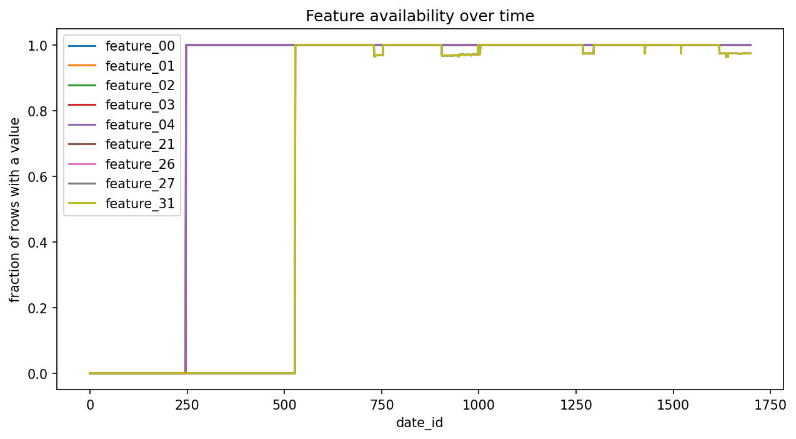

# Market Forecasting on Jane Street Data

Forecasting short-term market responders from noisy, non-stationary real-world
data, with a focus on honest (time-based) validation.

**Data:** Kaggle's *Jane Street Real-Time Market Data Forecasting* competition
(anonymised production market data: 79 features, 9 responders). The data is not
included in this repo; download it from Kaggle after accepting the competition rules.

## Goal
Predict the target responder as accurately as possible, measured by the
competition's weighted R², while avoiding data leakage.

## Status
- [x] Data loaded and explored
- [ ] Validation scheme
- [ ] Baselines
- [ ] Neural models
- [ ] Analysis and write-up

## Findings so far
- The dataset has 10 partitions covering about 1,700 days and 20+ symbols per slice.
- Feature availability changes over time. Features 00-04 are entirely missing
  before date 247, and features 21, 26, 27 and 31 are missing before date 528
  (switch-on measured as the first date where more than half of rows have a value).
  After switching on, availability stays near 100% with brief temporary drops.
  Possible explanation (untested): the underlying data sources changed over time.
  This matters for modelling because a model trained on early dates never sees
  these features.
  

## Methods
**Validation:** walk-forward, split by date (never random). Three validation blocks of
150 days each, taken from the most recent data (dates 1249-1698). For each block the
model trains only on earlier dates, with a 20-day gap before the block to avoid leakage
across the boundary.

**Metric:** sample-weighted zero-mean R² on responder_6 (the competition metric).
Sanity checks: predicting zero scores exactly 0; predicting the training mean scores
about ±0.00003 on all three folds. Scores in this problem are tiny; the best
leaderboard scores were around 0.006-0.01.

## Results
*(to be filled in)*

## What didn't work
*(to be filled in)*

## How to run
*(to be filled in)*
